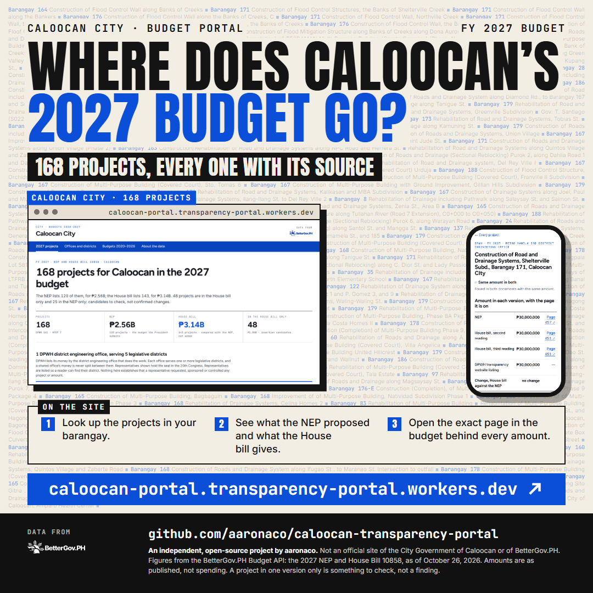

# Caloocan City Budget Transparency Portal

**Live site:** [caloocan-portal.transparency-portal.workers.dev](https://caloocan-portal.transparency-portal.workers.dev)

Where does Caloocan's share of the national budget go? This site lists every 2027 budget
project for Caloocan City. It puts the President's proposal (the NEP) side by side with
the House version (House Bill 10858), shows what got added or dropped, and links every
amount to the exact page of the budget document it came from. You can also look back at
the budgets passed from 2020 to 2026.

<p align="center">
  
</p>

## Why I made this

Part of an open invitation to build a budget transparency portal for your own province, city, town or DPWH
office. This is for Caloocan.

From [bettergovph/transparency-portal](https://github.com/bettergovph/transparency-portal),
and all the numbers come live from the [BetterGov.ph Budget API](https://budget.bettergov.ph/docs).

This is an independent project. It isn't an official site of the City Government of Caloocan.

## Before you read the numbers

- **These are budget amounts, not money spent.** A budget is permission to spend.
- **"Only in the House bill" or "only in the NEP" isn't proof of anything.** It means the
  project is worth a closer look, not that someone inserted or cut it.
- **A dash is not zero.** It means that version of the budget doesn't have the line.
- **The NEP and the House bill are never added together.** They're two versions of the
  same budget.

## What's on the site

| Page                  | What you'll find                                                                                                                             |
| --------------------- | -------------------------------------------------------------------------------------------------------------------------------------------- |
| **2027 projects**     | Every project, with search, filters, sorting and a CSV download. The DPWH office and Caloocan's three districts, with their representatives. |
| **Budgets 2020–2026** | The budgets passed in past years for anything named after Caloocan, year by year.                                                            |
| **A project**         | The amount in each version, with a link to the exact PDF page.                                                                               |
| **About the data**    | Every search the site runs, every line I removed and why, and the source documents.                                                          |

## How Caloocan's projects are picked

- **North and South Caloocan are one city here.** They're one LGU, so they're one portal.
- **Three districts:** Caloocan City 1st, 2nd and 3rd.
- **One DPWH office:** the Metro Manila 3rd District Engineering Office. It covers both
  Caloocan and Valenzuela, so its office card shows the whole office's budget. DPWH
  doesn't split it by city, and neither do I.
- **Projects come in two ways:** everything listed under that office, and anything in the
  DPWH, health facility, farm-to-market road or irrigation lists whose title says
  "Caloocan". Only NCR counts, so a Barangay Caloocan in another province stays out.
- **Valenzuela projects are taken out.** If a line under the shared office says
  "Valenzuela City" in its title, I removed it. Every one is listed on the About page.
- **One limit:** the budget documents don't say which city a project is in. If a title
  doesn't name a city at all, it stays in, even though a few of those may be Valenzuela's.

All of this lives in one file: [`portal.config.ts`](portal.config.ts).

## Development

```bash
npm install
npm run check     # tests the config against the live API
npm run dev       # http://localhost:5132
```

## Deploying

The site runs on Cloudflare Workers:

```bash
npx wrangler login
npm run deploy:cloudflare
```

## License

MIT. See [LICENSE](LICENSE). The budget documents are works of the Philippine government.
